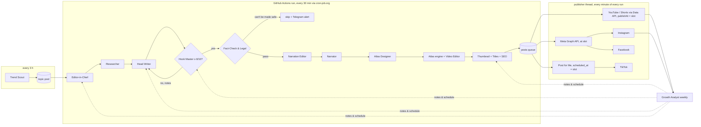

# Architecture

## The agent team

| # | Agent | Prompt | Does | Output |
|---|---|---|---|---|
| 1 | **Trend Scout** | `trend_scout.md` | Every 3 h: pulls Google Trends PH, 5 news feeds, X/Twitter PH trends, YouTube + Google autocomplete for 13 seed keywords, Reddit (optional), YouTube mostPopular PH (optional), and the civic calendar. Stores every value so the next run can measure **acceleration**, then ranks topics that are about to peak, each with the viewer's question and the system behind it. | `topics` table |
| 2 | **Editor-in-Chief** | `editor_in_chief.md` | When a slot enters the production window, assigns the freshest fitting topic, balancing the pillars (`how_it_works`, `now_explained`, `myths_factchecks`) and avoiding repeats. | brief per item |
| 3 | **Researcher** | `researcher.md` | Anthropic web search (up to 25 searches), primary sources first: the viewer's question, timeline, the exact rule text with section, key facts with `[S#]` citations, people (established vs. alleged), how it plays out, another democracy's design. | `dossier.md` |
| 4 | **Head Writer** | `scriptwriter.md` | Style v2 Taglish narration: the viewer's question, the steps with the real rule and section, the turn, a fair comparison, a close with a new consequence. Numbers as digits. | `script_r*.json` |
| 5 | **Retention Editor** | `hook_master.md` | Sharpens the opening question and the payoff without slogans; scores hook and retention. Below the bar, notes go back to the writer (max 3 drafts, then the slot is skipped). | `hook_r*.json` |
| 6 | **Fact-Check & Legal** | `fact_checker.md` | Checks every line against the dossier, enforces cyber-libel rules, applies the naming policy (names only for history or final convictions, otherwise roles), keeps each side's stated reason, and rewrites in the v2 voice; anything it can't make safe is skipped automatically. | `factcheck.json` |
| 7 | **Narration Editor** (prevention) | `narration_editor.md` | Before any voice is recorded: numbers stay digits (the engine reads them in English), Tagalog number words go back to digits, acronyms hyphenated, no word split across scenes. | `narration.json` |
| 8 | **Narrator** | (code: `media/tts.py`, `media/tts_voxcpm.py`) | VoxCPM2 clone of the approved narrator, one take per line scored by Whisper. The local RTX 3080 worker narrates first (`tools/voice_worker.py`); Modal (`tfs-voice`) only after the deadline or when the PC is off. | `audio/*` |
| 9 | **Atlas Designer** | `prompts/atlas_designer.md` | Plans every shot, word-anchored: the paper map and globe, the exact law text with a red circle, number cards and charts, checklists and stamps, licensed Wikimedia photos and footage in media cards, the 3D Metro Manila push; variety rules per scene family. | `atlas.json`, `atlas_shots.json` |
| 10 | **Video Editor** | (code: `media/atlas.py`, `media/atlas_plan.py`, `engine/runtime/atlas*.js`, `media/sfx_v2.py`) | Builds one HTML composition on a GSAP timeline; HyperFrames films it in headless Chrome at 60 fps. Synthesized SFX on every visual event, mastered to -14 LUFS, karaoke captions, SRT and chapters. | `video.mp4` |
| 11 | **Thumbnail Artist** | `thumbnail_artist.md` | Picks the strongest real frame of the finished video and at most 4 English words on top, composited at 1280x720. | `thumbnail.jpg` |
| 12 | **Title Writer** | `title_writer.md` | 10 English options scored for curiosity, clarity, keyword fit and honesty; primary + 2 alternates for later swaps. | `titles.json` |
| 13 | **SEO & Discovery Writer** | `seo_writer.md` | Description written for YouTube search *and* AI answer engines, chapters, sources, tags, and native captions for Shorts / IG / FB / TikTok. | `seo.json` |
| 14 | **Publisher** | (code: `publish/youtube.py`, `publish/meta.py`, `publish/postforme.py`, `publish/threads.py`) | YouTube + Shorts upload directly through the TFS Automation Google Cloud project with native `publishAt` scheduling, custom thumbnail and the synthetic-media flag. IG and FB Reels go direct through the Meta app TFS Content Creator at the slot time. TikTok goes through Post for Me with `scheduled_at` = slot, and each result is confirmed afterwards. | `posts` table |
| 15 | **Growth Analyst** | `analyst.md` | Weekly: YouTube Analytics + IG insights: what worked, standing notes for each agent, schedule retune, title swaps on low-CTR videos. | `analyst_notes_v2/` |
| 16 | **Proofreader** | `audio_qa.md` | Whisper (faster-whisper, `small`) transcribes the finished video. Each scene is word-matched against the script, and a Claude judge decides which differences are real: skipped words, wrong numbers or names, garbled audio. Failing scenes are re-voiced, respelled in English number words if pronunciation was the problem. | `qa_r*.json` |
| 17 | **Visual QA** | `visual_qa.md` | Looks at a frame from every shot (plus the hook frame and thumbnail) next to what it was meant to show: wrong facts on screen, identifiable living people, cut text, missing photo credits, empty frames, non-English text or dashes on screen, and appeal. Blocking scenes go back to the Atlas Designer with a note, up to 2 rounds; a piece that passes but scores below 7/10 gets one polish pass, kept only if it still passes and scores at least as well. | `qa_r*.json`, `qa_fixes.json` |
| 18 | **Creative Director** (learning) | `creative_director.md` | Twice a day, turns recurring Visual QA notes into up to 8 standing instructions each for the Atlas Designer and the Thumbnail Artist. Sends a short summary to Telegram. | `creative_notes_v2/*.md` |

Briefs live in `prompts/v2/` (the Atlas Designer's in `prompts/`). Carousels are paused until a style v2 carousel
design exists.

Every agent's system prompt = `docs/STYLE_BIBLE_V2.md` + its role prompt (`prompts/v2/`) + the analyst's standing notes
(prompt-cached, so the shared prefix is billed at the cache rate).

## Flow

## Daily output (config/schedule.yaml)

| Produced | Published as |
|---|---|
| 1 long-form (8–15 min, 16:9) — scale later by adding slots | 1 × YouTube long-form (21:00 PHT) |
| 3 verticals (35–58 s, 9:16) | 3 × Shorts, 3 × IG Reels, 3 × FB Reels, 3 × TikTok — same master, all platforms at the same moment (04:30, 12:30, 20:30 PHT), platform-native captions |
| carousels | paused until a style v2 carousel design exists |

## Reliability

- **Checkpointed**: every step writes its artifact to `TFS_DATA_DIR/items/<id>/`; a crash or approval pause resumes where it stopped.
- **Prevent first, then review**: the Narration Editor and the Atlas Designer's variety check fix problems before anything is rendered. The review team then blocks only safety/legal issues, garbled or non-English text, wrong on-screen facts and identifiable living people. A narration flag blocks only when the same scene is flagged again after a re-voice; one-off flags appear as notes in the Telegram "Ready" message, which includes how to pull that post (`hold` workflow with the item id).
- **Skip, don't ship junk**: failing the quality bar, a fact-check reject, or missing the first slot → the slot is skipped and you're notified.
- **Publishing never waits for production**: inside each run, a publisher thread checks every minute. A run
  stays up for any Facebook/Instagram post due within 35 minutes, and runs never overlap (concurrency group).
- **Fully cloud, no server**: cron-job.org triggers the GitHub Actions `run` workflow every 30 min. State (SQLite
  DB, notes, media of unposted items) lives in a private R2 bucket: it's restored at the start of each run and
  saved after every step and every publish, with a dated DB backup daily.
- All times are Asia/Manila.

## Running costs (1 long-form + 3 verticals a day; verify current prices)

| Item | Basis | ≈ / month |
|---|---|---|
| Claude — Max subscription via Claude Code (default) | flat plan, within its 5-hour/weekly usage limits | the Max plan you already pay |
| … or Claude API (`llm.backend: api`) | ~$3.5 per long-form, ~$1.2 per vertical, ~$1 per carousel incl. web search | ~$275 |
| Narration (VoxCPM2) | local RTX 3080 first; Modal L4 only as fallback (about US$0.003 per second of narration) | $0 to ~$30 |
| Pictures (atlas engine: GSAP, HyperFrames (Apache-2.0), d3-geo and world-atlas (ISC), Wikimedia Commons photos) | rendered on the GitHub runner | $0 |
| Post for Me (TikTok only) | ~90 posts/month | $10 |
| GitHub Actions (public repo) + cron-job.org | standard runners | $0 |
| Cloudflare R2 state | a few GB (media pruned after 10 days) | ~$0 (free tier: 10 GB) |
| **Total** | | **about $10 to $40 + your Max plan** |

